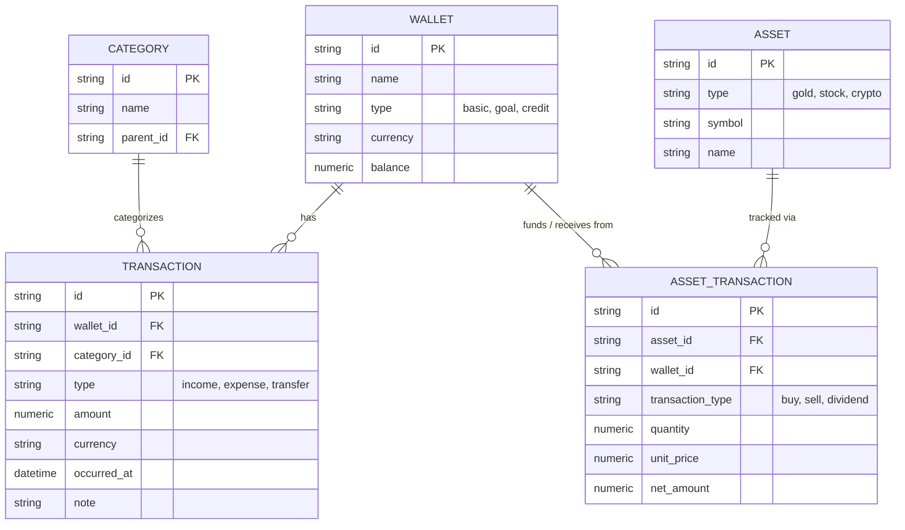
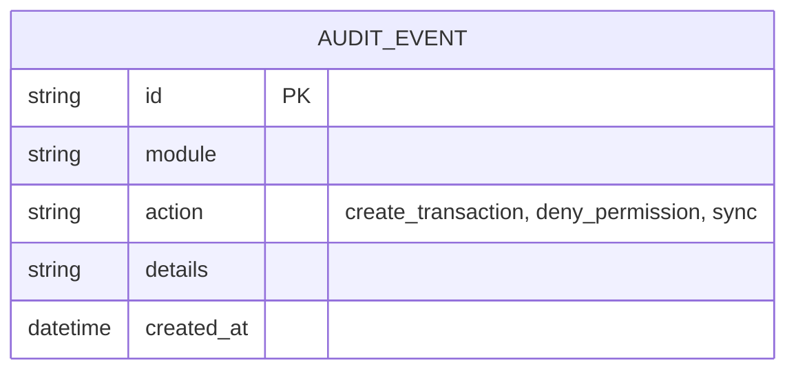

# Entity Relationship Diagram

## Field Ownership

- Human owns data ownership rules (which system owns what).
- AI maintains entities, relationships, and data dictionaries.

## Data Ownership Rules

According to the Source of Truth matrix (`docs/raw_spec/spec.md`):
- **Finance Module**: Owns all its canonical data within Cortex PostgreSQL (Wallets, Categories, Transactions, Assets).
- **Second Brain Module**: Owns only its *capture buffer* in PostgreSQL. The canonical Vault data is owned by local Obsidian files and is mirrored/indexed by Cortex.
- **Homelab Module**: Completely read-only, sourcing from GitHub repos.

## Finance Entities

## System / Event Entities

