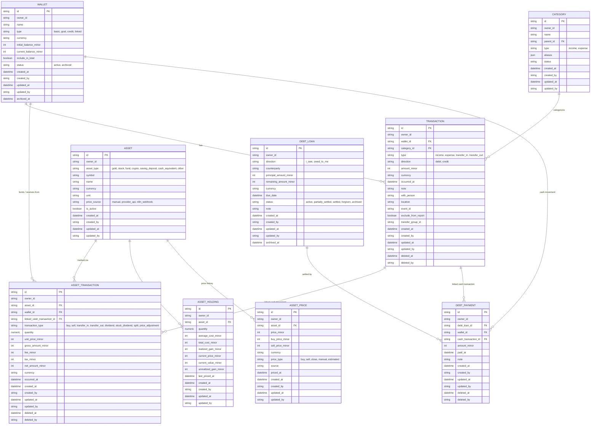
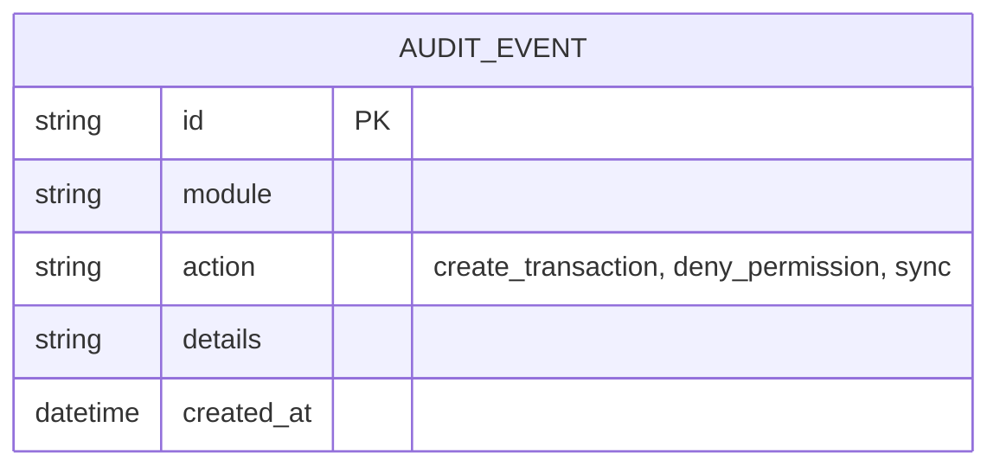

# Entity Relationship Diagram

## Field Ownership

- Human owns data ownership rules (which system owns what).
- AI maintains entities, relationships, and data dictionaries.

## Data Ownership Rules

According to the Source of Truth matrix (`docs/raw_spec/spec.md`):
- **Finance Module**: Owns all its canonical data within Cortex PostgreSQL (Wallets, Categories, Transactions, Assets).
- **Second Brain Module**: Owns only its *capture buffer* in PostgreSQL. The canonical Vault data is owned by local Obsidian files and is mirrored/indexed by Cortex.
- **Homelab Module**: Completely read-only, sourcing from GitHub repos.

## Finance Entities

The Finance database separates cashflow from investment valuation:

- `transactions` represent income, expense, transfer, and cash movement records.
- `asset_transactions` represent historical investment events and execution prices.
- `asset_holdings` represent current derived positions and cost basis.
- `asset_prices` preserve market/manual price history.
- Net worth is computed from included wallet balances plus current asset values minus liabilities.
- Debt/loan tracking distinguishes money I owe from money owed to me.
- Finance tables carry auditable fields so each row records actor and timestamp metadata.
- Financial period reports use business-effective timestamps such as `occurred_at`, `paid_at`, `priced_at`, and `as_of`; `created_at` is only the system record creation timestamp.

### Finance Valuation Rules

- Historical purchase/sale price lives on `ASSET_TRANSACTION.unit_price_minor`.
- Current market value comes from the latest usable `ASSET_PRICE`.
- Price history is append-only for valuation purposes; do not overwrite prior market prices.
- Default cost basis is weighted average.
- Deterministic price priority:
  - Gold: latest `sell_price`, latest generic `price`, latest manual fallback.
  - Stocks/funds/crypto: latest close, latest last, latest manual fallback.
  - Saving deposit: principal plus accrued interest when available; otherwise latest manual value.
- Investment buys may reduce wallet cash but must not count as living expenses.
- `ASSET_HOLDING` is a rebuildable projection from `ASSET_TRANSACTION` plus latest usable `ASSET_PRICE`.
- `DEBT_LOAN.direction = i_owe` is a liability and subtracts from net worth.
- `DEBT_LOAN.direction = owed_to_me` is a receivable and adds to net worth.
- Debt payments/collections link to cash transactions so wallet balances and debt balances stay aligned.

### Finance Query Rules

- Use `TRANSACTION.occurred_at` for financial period reports, not `TRANSACTION.created_at`.
- Use `created_at`/`created_by` and `updated_at`/`updated_by` for operational audit views.
- Net-worth reads combine `WALLET.current_balance_minor`, `ASSET_HOLDING.current_value_minor`, latest usable `ASSET_PRICE`, and active `DEBT_LOAN.remaining_amount_minor`; they must not scan raw transaction history for normal reads.
- Money fields use `BIGINT` minor units and the `_minor` suffix. Quantity fields use `NUMERIC(30, 12)`.
- Transfers are stored as two `TRANSACTION` rows with the same `transfer_group_id`: one `transfer_out` row and one `transfer_in` row.
- Soft delete is limited to `TRANSACTION`, `ASSET_TRANSACTION`, and `DEBT_PAYMENT`; soft-deleted rows are excluded from reports, valuation rebuilds, and debt settlement calculations.
- Linked asset/debt cash movement rows require correction or reversal commands so related records stay consistent.
- Initial report indexes:
  - `transactions(owner_id, occurred_at DESC)` where `deleted_at IS NULL`
  - `transactions(owner_id, wallet_id, occurred_at DESC)` where `deleted_at IS NULL`
  - `transactions(owner_id, category_id, occurred_at DESC)` where `deleted_at IS NULL`
  - `transactions(owner_id, type, occurred_at DESC)` where `deleted_at IS NULL`
  - `transactions(owner_id, exclude_from_report, occurred_at DESC)` where `deleted_at IS NULL`
  - `transactions(owner_id, transfer_group_id)` where `transfer_group_id IS NOT NULL`
  - `asset_transactions(owner_id, asset_id, occurred_at, created_at, id)`
  - `asset_holdings(owner_id, asset_id)` unique
  - `asset_prices(owner_id, asset_id, priced_at DESC)`
  - `debt_loans(owner_id, direction, status, due_date)`
  - `debt_payments(owner_id, debt_loan_id, paid_at DESC)`
- Initial constraints:
  - active wallet names are unique per owner
  - category names are unique per owner, type, and parent
  - assets are unique per owner, asset type, symbol, and currency
  - `asset_holdings(owner_id, asset_id)` is unique
  - `_minor` amount fields are positive and `remaining_amount_minor` is non-negative
  - linked finance rows must stay inside the same `owner_id`

## System / Event Entities

