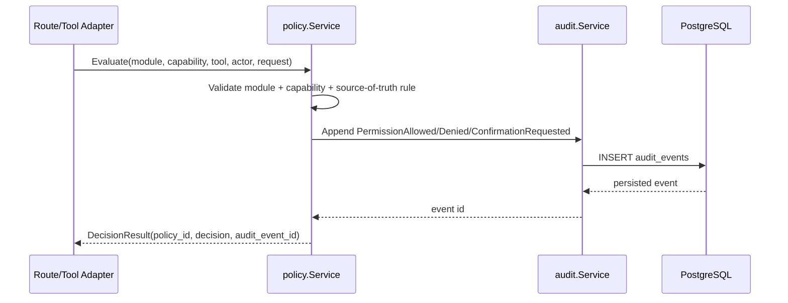

# Detail Design: Audit Logging And Capability Guard

## Approval Status

Pending human/design approval before code implementation.

## Problem Statement

Cortex is about to add an Orchestrator and tool runtime. Before any AI-driven write, sync, index, or RAG tool call is allowed, the system needs two primitives:

- An append-only audit event log for lineage, debugging, permission decisions, and sensitive operations.
- A capability guard that decides whether a module/tool call is allowed, denied, requires confirmation, requires clarification, or requires manual action.

This is high-risk because it touches security/privacy, data model, API contracts, and cross-module behavior. It must be implemented as testable Go system services before being wired into all runtime routes.

## Context Loaded

- `docs/CONTEXT.md`
- `docs/work/BACKLOG.md`
- `docs/standards/README.md`
- `docs/standards/QUALITY_BAR.md`
- `docs/standards/VALIDATION.md`
- `docs/standards/CODE.md`
- `docs/standards/TESTING.md`
- `docs/standards/DOCS.md`
- `docs/raw_spec/spec.md`
- `docs/raw_spec/system/audit-events.md`
- `docs/raw_spec/system/permission-policy.md`
- `docs/raw_spec/system/source-of-truth-sync.md`
- `docs/work/phases/PHASE-4-audit-policy.md`
- `docs/work/tickets/CTX-401.md`
- `docs/work/tickets/CTX-402.md`
- Direct implementation patterns:
  - `src/backend/migrations/000001_init.up.sql`
  - `src/backend/internal/infrastructure/db/postgres.go`
  - Finance service/test package layout under `src/backend/internal/modules/finance/`

## Brownfield Touched Scope

Planned code scope:

- `src/backend/migrations/000002_audit_events.up.sql`
- `src/backend/internal/modules/system/audit/`
- `src/backend/internal/modules/system/policy/`
- Focused tests under those packages.

Direct dependencies:

- GORM/PostgreSQL connection style already used by backend.
- Existing Finance tests, because the migration must not break prior Finance schema.
- Existing Go gateway tests, because system package additions must not break `go test ./...`.

Known unknowns:

- Auth/session user identity does not exist yet. v1 uses the current single-user owner/actor convention and accepts explicit actor/request IDs in commands.
- Orchestrator tool registry is not implemented yet. Policy service will expose stable Go APIs now; route/tool integration should happen in the Orchestrator ticket.
- No production migration runner exists in Go yet; tests can execute SQL migration files directly, matching existing finance migration smoke style.

## Proposed Architecture

```text
Title: Audit And Permission System Components

+-----------------------------+
| Future Orchestrator / Tool  |
| Adapter / Go Route Handler  |
+--------------+--------------+
               |
               v
+-----------------------------+
| policy.Service              |
| - validate module/capability|
| - apply source-of-truth rule|
| - decide allow/deny/confirm |
+--------------+--------------+
               |
               v
+-----------------------------+
| audit.EventSink interface   |
| AppendEvent(ctx, command)   |
+--------------+--------------+
               |
               v
+-----------------------------+
| audit.Service / Repository  |
| append-only event writes    |
| query by request/module/ref |
+--------------+--------------+
               |
               v
+-----------------------------+
| PostgreSQL audit_events     |
+-----------------------------+
```

### CTX-401: Audit Logging API

Add a Go system module `internal/modules/system/audit`:

- Domain model:
  - `Event`
  - `AppendEventCommand`
  - `ListEventsQuery`
  - `SourceRef` / `TargetRef` represented as JSON metadata maps in Go.
- Service methods:
  - `AppendEvent(ctx, command) (Event, error)`
  - `GetEvent(ctx, id) (Event, error)`
  - `ListEvents(ctx, query) ([]Event, error)`
  - `ListEventsByRequest(ctx, requestID) ([]Event, error)`
  - `ListModuleTimeline(ctx, module, query) ([]Event, error)`
- Repository:
  - GORM-backed repository for PostgreSQL.
  - No update/delete methods.

Database table:

```text
audit_events
  id TEXT PRIMARY KEY
  event_type TEXT NOT NULL
  module TEXT NOT NULL
  actor_type TEXT NOT NULL
  actor_id TEXT NOT NULL
  conversation_id TEXT NOT NULL DEFAULT ''
  request_id TEXT NOT NULL DEFAULT ''
  tool_name TEXT NOT NULL DEFAULT ''
  capability TEXT NOT NULL DEFAULT ''
  source_ref JSONB NOT NULL DEFAULT '{}'
  target_ref JSONB NOT NULL DEFAULT '{}'
  status TEXT NOT NULL
  metadata JSONB NOT NULL DEFAULT '{}'
  created_at TIMESTAMPTZ NOT NULL
```

Indexes:

- `(module, created_at DESC)`
- `(request_id, created_at DESC)` where `request_id <> ''`
- `(event_type, created_at DESC)`
- GIN on `source_ref` and `target_ref`

Validation rules:

- Required: `event_type`, `module`, `actor_type`, `actor_id`, `status`.
- `status` allowed values: `success`, `failed`, `denied`, `skipped`.
- Metadata must be JSON-serializable.
- Secret-looking keys (`password`, `token`, `secret`, `api_key`, `authorization`, `credential`) are rejected recursively from metadata/source/target refs.

Append-only enforcement:

- Application service exposes no update/delete.
- DB migration grants no trigger yet because role-level hardening is outside current local setup.
- Tests prove repository has append/get/list only and no normal deletion path.

### CTX-402: Capability Guard

Add a Go system module `internal/modules/system/policy`:

- Domain model:
  - `Capability`
  - `Module`
  - `Decision`
  - `EvaluateCommand`
  - `DecisionResult`
- Service method:
  - `Evaluate(ctx, command) (DecisionResult, error)`
- Optional helper:
  - `RequireAllowed(ctx, command) error`

Policy matrix is static for v1 and based on raw spec:

| Module | Allowed capabilities |
| --- | --- |
| `finance` | `read`, `write_app_db`; optional `rag_query`, `capture`, `sync_from_external`, `index_external_source` as configured false by default |
| `second_brain` | `read`, `rag_query`, `capture`, `write_app_db` for capture/metadata only, `index_external_source` |
| `homelab` | `read`, `rag_query`, `write_app_db` for sync/index metadata only, `sync_from_external`, `index_external_source` |

Hard denials:

- `homelab.write_external_source`
- `homelab.execute_runtime_action`
- `second_brain.write_external_source`
- Any module `execute_runtime_action` in v1
- Unknown module or unknown capability
- `manage_policy` unless caller is future admin/system policy surface

Confirmation decisions:

- Finance `write_app_db` with high impact, ambiguous input, low confidence, or money movement marker returns `require_confirmation`.
- Confirmation cannot override hard denial.

Every decision for write/sync/index/RAG produces an audit event:

```text
policy.Evaluate
  -> compute decision
  -> audit.AppendEvent(PermissionAllowed | PermissionDenied | ConfirmationRequested)
  -> return DecisionResult
```

Read-only `read` may be audited only when caller opts in, to avoid noisy logs during initial development.

## Request Flow



## Alternatives Considered

### Alternative A: Put audit fields/events inside every module

Rejected. Finance already has auditable row fields, but permission/tool/runtime audit is cross-cutting. Per-module event tables would fragment request lineage and make Orchestrator debugging harder.

### Alternative B: Implement policy as Echo middleware only

Rejected for v1. Most important calls will come from Orchestrator/tool adapters and internal services, not only HTTP routes. A pure service is easier to unit test and can later be wrapped by middleware.

### Alternative C: Use external audit/logging stack first

Rejected. The raw spec requires Cortex-owned audit/event APIs. External logs can complement this later, but they cannot be the canonical audit trail for policy decisions.

## Impact

| Area | Impact |
| --- | --- |
| API/contract | Adds internal Go service APIs for audit and policy. No public HTTP routes required in first slice. |
| Data model | Adds `audit_events` table and indexes. |
| Security/privacy | Adds metadata secret-key rejection and permission decision audit. |
| Runtime | No mandatory runtime wiring yet; later Orchestrator/tool adapter must call policy before tools. |
| Existing Finance | Must remain green; no behavior change in this slice. |
| Existing AI service/gRPC | No behavior change in this slice. |
| Docs | ERD/API/Architecture/Validation/Changelog update after implementation. |

## Verification Plan

Commands expected after implementation:

```bash
cd src/backend && go test ./internal/modules/system/...
cd src/backend && go test ./...
PYTHONPATH=src src/ai_service/.venv/bin/python -m unittest discover -s src/ai_service/tests -v
git diff --check
```

Required test coverage:

- Audit append/get/list success.
- Audit validation rejects missing required fields.
- Audit validation rejects secret-looking metadata keys recursively.
- Audit list by `request_id` and module timeline returns expected ordering.
- Policy allows known safe capability.
- Policy denies hard read-only boundary (`homelab.write_external_source`).
- Policy requires confirmation for high-impact Finance write.
- Policy writes audit event for allow/deny/confirmation decisions.
- Full backend suite remains green.

## Reconciliation Plan

After implementation:

- `docs/architecture/ARCHITECTURE.md`: add system services implementation details if behavior changes from master doc.
- `docs/architecture/API.md`: add internal Audit/Policy service API signatures.
- `docs/architecture/ERD.md`: add `audit_events`.
- `docs/work/VALIDATION_MATRIX.md`: add CTX-401 and CTX-402 proof rows.
- `docs/releases/CHANGELOG.md`: add audit/policy entry.
- `docs/CONTEXT.md` and `docs/work/BACKLOG.md`: update active status.
- ADR: not required if implementation follows existing raw spec and ADR-002 module boundary; create one only if the policy model changes materially.

## Approval Needed

Human/design approval is needed before implementation because this adds a security-sensitive system service and a new database table.
