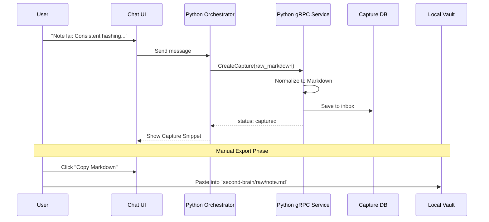

# Epic 2 Detail Design: Second Brain Services (Python AI Service)

This detail design covers the implementation of the Second Brain module, fulfilling tickets CTX-201 (Capture Buffer API), CTX-202 (Sync Status API), and CTX-203 (Vault RAG Query API). Following ADR-003, this module is implemented as a standalone **Python AI service**. Python owns Orchestrator/LLM runtime and AI/RAG-heavy processing. Go owns API-heavy deterministic services. The durable Go/Python boundary is internal gRPC.

## Approval

- **Status**: Approved
- **Approver**: dungxbuif
- **Date**: 2026-06-17

## Resolved Decisions

- **Database Architecture**: Python Second Brain uses the same PostgreSQL instance/database as Cortex and owns prefixed tables: `secondbrain_captures`, `secondbrain_documents`, and `secondbrain_document_chunks`. This keeps local deployment simple, allows shared owner/audit conventions, and preserves a clean module boundary through table ownership and service APIs.

## Proposed Architecture

The `secondbrain` module is an independent Python AI service. It is called by the Python Orchestrator directly when deployed together, or through internal gRPC when split into a separate process. Go domain/API services communicate with the Python Orchestrator through internal gRPC. FastAPI remains an optional development/debug adapter and is not the authoritative integration contract.

### Component Structure
```text
Cortex
  src/
    backend/             Go orchestrator/API gateway
    secondbrain/         Python Second Brain service
      secondbrain/
        api.py           Optional FastAPI dev/debug transport adapter
        grpc/            Future generated/server-side gRPC transport boundary
        service.py       Capture, sync status, and search use cases
        repository.py    Local PostgreSQL pgvector psql adapter
        markdown.py      Markdown/frontmatter parser and semantic chunker
        vector.py        Deterministic local embedding/scoring helpers
      tests/
        test_secondbrain_service.py
        testdata/        Local real-vault fixtures, gitignored
```

### 1. Capture Lifecycle Flow (CTX-201)


### 2. Sync & RAG Query Pipelines (CTX-202 & CTX-203)
```mermaid
sequenceDiagram
    participant Local Vault
    participant Python Indexer
    participant PostgreSQL + pgvector
    participant Python Orchestrator
    
    Note over Local Vault, PostgreSQL + pgvector: Sync Pipeline (CTX-202)
    Local Vault->>Python Indexer: Vault Snapshot
    Python Indexer->>Python Indexer: Parse Markdown, YAML & Heading Chains
    Python Indexer->>PostgreSQL + pgvector: Upsert Documents Metadata
    Python Indexer->>Python Indexer: Semantic Chunking (Headers/Links)
    Python Indexer->>PostgreSQL + pgvector: Upsert Chunks & Embeddings
    
    Note over Python Orchestrator, PostgreSQL + pgvector: RAG Query Pipeline (CTX-203)
    Python Orchestrator->>Python gRPC Service: SearchKnowledge(query: "cache scaling")
    Python gRPC Service->>Python gRPC Service: Embed Query String
    Python gRPC Service->>PostgreSQL + pgvector: Hybrid Search (Vector + Full-text + Metadata Filter)
    Python gRPC Service->>Python gRPC Service: Apply Lifecycle Ranking (Wiki > Staging > Raw)
    PostgreSQL + pgvector-->>Python gRPC Service: Return Top K Chunks
    Python gRPC Service-->>Python Orchestrator: Context for LLM Answer
```

## Data Model (SQLAlchemy/SQLModel)

### 1. `secondbrain_captures`
Temporary notes. Not available to RAG pipeline.
- `id`: PK
- `status`: `captured`, `copied`, `exported`, `discarded`
- `raw_text`: Original text
- `normalized_markdown`: Transformed markdown content
- `vault_path`: Target path if exported

### 2. `secondbrain_documents`
Indexed metadata of the canonical Obsidian Vault.
- `id`: PK
- `vault_path`: Unique Path
- `checksum`: File hash
- `document_type`: `raw`, `staging`, `wiki`, `tracking`, etc.
- `frontmatter`: JSONB

### 3. `secondbrain_document_chunks`
Text chunks and their embeddings for Vector Search.
- `id`: PK
- `document_id`: FK -> `secondbrain_documents`
- `chunk_index`: INT
- `content`: TEXT
- `heading_chain`: JSONB Array
- `embedding`: VECTOR(768), aligned with `gemini-embedding-2` recommended smaller output dimension for efficient RAG storage.

## Implementation Checkpoint

Current implementation provides a deterministic local core that can be tested without external AI services:

- Capture lifecycle and markdown normalization.
- Local PostgreSQL-backed integration repository using `psql`, tested against DB `cortex` with user `dev`.
- `pgvector` extension is enabled in local DB `cortex`; `secondbrain_document_chunks.embedding` is verified as type `vector` with 768 dimensions.
- DB/model settings are read from environment variables via `SecondBrainSettings`.
- Versioned SQL migrations live under `src/secondbrain/migrations/`; local DB has applied `000001_secondbrain_pgvector`.
- Markdown/frontmatter parsing and heading-aware chunking.
- Sync status from indexed document/chunk counts.
- Hybrid retrieval scoring using deterministic hashed embeddings, lexical overlap, path/title boosts, lifecycle boosts, query expansion, out-of-scope thresholding, and hard policy filters.
- Real local Vault testdata currently indexes 91 markdown documents and passes 18/18 ground-truth retrieval checks.
- Optional FastAPI adapter in `src/secondbrain/api.py`; runtime server requires installing Python dependencies from `src/secondbrain/pyproject.toml`.
- FastAPI `TestClient` exercises `/api/v1/capture`, `/api/v1/capture`, `/api/v1/sync/status`, and `/api/v1/search` against the same PostgreSQL pgvector repository as a dev/debug adapter proof.
- Python Orchestrator integration and gRPC protobuf definitions for cross-runtime Go/Python domain service calls remain the next integration step.
- Google API smoke tests exist for `gemini-embedding-2` and generation model configuration. They are opt-in with `SECOND_BRAIN_RUN_GOOGLE_SMOKE=true` because they call external paid/limited APIs.

Verification command:

```text
PYTHONPATH=src src/secondbrain/.venv/bin/python -m unittest discover -s src/secondbrain/tests -v
```

## Testing Strategy & Quality Gates

The Python test suite will run 6-layer evaluations ensuring high RAG quality and privacy compliance.

**Golden Tests (4 Dimensions)**
1. `second_brain_chunks.json`: Validates semantic chunker outputs.
2. `second_brain_metadata.json`: Validates parsing logic.
3. `second_brain_link_graph.json`: Validates internal connections.
4. `second_brain_rag_policy_report.json`: Validates search constraints.

**Eval Dataset (JSONL)**
```json
{"question":"Consistent hashing là gì?","expected_paths":["wiki/system-design/consistent-hashing.md"],"must_rank_above":["staging/consistent-hashing-digest.md","raw/consistent-hashing-raw.md"]}
{"question":"Tôi đang học gì liên quan Python?","expected_paths":["tracking/learn-python.md"]}
{"question":"Note vừa capture trong chat có được RAG đọc chưa?","expected_paths":[],"expected_answer_policy":"capture_db_not_rag_source"}
```

**9 CI Quality Gates (Mandatory)**
- `pytest unit tests pass`
- `golden tests pass`
- `capture_db_rag_leak_count == 0` (Zero leak for capture db)
- `rag_false_leak_count == 0` (Zero leak for non-RAG notes)
- `private_note_leak_count == 0` (Zero leak for private notes)
- `citation_coverage == 100%`
- `archive_pollution_rate == 0%`
- `top_3_retrieval_accuracy >= 85%`
- `wiki_priority_accuracy >= 90%`
