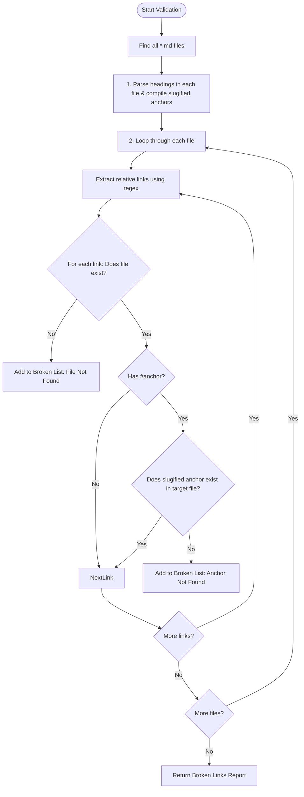

# DETAIL_DESIGN: Homelab Readonly RAG & Link Verification

This design describes the architecture, database schema, algorithms, and integration points for the Homelab module. Homelab is a read-only knowledge module that syncs from a Git repository, indexes markdown files with pgvector RAG, and validates all internal relative links.

---

## 1. Context Loaded & Reference Links

- **Backlog Item**: [BL-005](../../BACKLOG.md)
- **Active Phase**: [PHASE-3-homelab.md](../../phases/PHASE-3-homelab.md)
- **Active Tickets**:
  - [CTX-301: Homelab RAG Query API](CTX-301.md)
  - [CTX-302: Markdown Link Verification API](CTX-302.md)
- **Spec Source**: [docs/raw_spec/modules/homelab.md](../../../raw_spec/modules/homelab.md)
- **Architecture Base**: [docs/decisions/ADR-003-second-brain-python-migration.md](../../../decisions/ADR-003-second-brain-python-migration.md)

---

## 2. Problem Statement

Cortex needs to answer questions about the Homelab infrastructure based on the documentation in its Git repository. The design must ensure:
1. **Read-Only Enforcements**: Under no circumstances should Cortex modify the target Git repository or execute infrastructure configuration commands.
2. **Secret Redaction**: IaC documentation and config files must be audited and redacted so passwords, credentials, and sensitive private tokens are never stored in plain text or embedded in the vector database.
3. **Markdown Link Validation**: Relative links inside documentation often drift when files are moved. We must validate all relative markdown links (including header/anchor references) to maintain the documentation graph integrity.

---

## 3. Brownfield Touched Scope

The Python service `cortex-secondbrain` inside `src/secondbrain` is our focus. We will extend the existing service to incorporate the Homelab module:
- Modify `src/secondbrain/api.py` to add FastAPI route mappings.
- Add `src/secondbrain/homelab.py` to implement link checking, git indexing, and RAG retrieval.
- Add SQL migration `src/secondbrain/migrations/000002_homelab_tables.sql` to establish database tables.

---

## 4. System Architecture & Boundaries

The Homelab service runs under the Python runtime environment, sharing PostgreSQL connections and the Google AI client.

### Component Diagram

```text
+-------------------------------------------------------------+
| Go Backend / API Proxy (Deterministic Endpoint Handler)     |
+-------------------------------------------------------------+
                             |
                             | (FastAPI client / gRPC calls)
                             v
+-------------------------------------------------------------+
| Python Homelab Service (src/secondbrain/homelab.py)         |
+-------------------------------------------------------------+
         |                       |                       |
         | (Read file links)     | (Embed text)          | (CRUD state)
         v                       v                       v
+------------------+   +-------------------+   +--------------------+
| Local Git Mirror |   | Google AI Client  |   | PostgreSQL         |
| (dungxbuif/exam) |   | (urllib + retry)  |   | + pgvector         |
+------------------+   +-------------------+   +--------------------+
```

---

## 5. Database Schema Design

We will add two new database tables under pgvector to store Homelab document metadata and text chunks separately from the Second Brain tables.

| Table Name | Purpose | Column Definitions |
| --- | --- | --- |
| `homelab_documents` | Metadata for synced files | `id` (TEXT PRIMARY KEY)<br>`owner_id` (TEXT NOT NULL)<br>`repo_url` (TEXT NOT NULL)<br>`branch` (TEXT NOT NULL)<br>`commit_sha` (TEXT NOT NULL)<br>`file_path` (TEXT NOT NULL)<br>`checksum` (TEXT NOT NULL)<br>`index_status` (TEXT NOT NULL)<br>`indexed_at` (TIMESTAMPTZ NOT NULL)<br>Unique Index: `(owner_id, file_path)` |
| `homelab_document_chunks` | Text chunks and embeddings | `id` (TEXT PRIMARY KEY)<br>`document_id` (TEXT REFERENCES homelab_documents(id) ON DELETE CASCADE)<br>`owner_id` (TEXT NOT NULL)<br>`file_path` (TEXT NOT NULL)<br>`chunk_index` (INTEGER NOT NULL)<br>`content` (TEXT NOT NULL)<br>`heading_chain` (JSONB NOT NULL)<br>`token_count` (INTEGER NOT NULL)<br>`embedding` (VECTOR(768) NOT NULL) |

---

## 6. Markdown Link Validation Algorithm

The Link Validator crawls a local Git clone of the Homelab repository to find all broken relative links.



### GitHub-Flavored Markdown (GFM) Slugification Rules
To check if a fragment/anchor (e.g. `docs/MAIN.md#--service-export-playbook-end-to-end`) is valid:
1. **Slugification function**:
   - Convert the heading string to lowercase.
   - Remove all characters except alphanumeric (a-z, 0-9), hyphens, and spaces/underscores. Emojis and standard punctuation (such as `(`, `)`, `?`, `:`) are stripped completely.
   - Replace spaces with hyphens `-`.
   - Remove leading/trailing spaces or hyphens.
2. **Double hyphens handling**: Emojis like `🚀` followed by a space are stripped, which can leave a space before the next word, leading to double hyphens (e.g. `--service-export-playbook...`). Our resolver will handle multiple consecutive hyphens gracefully.

---

## 7. Security & Redaction Rules

Before indexing, documents must go through the **Secret Redaction Pipeline**:
1. **Exclusion List**: The folders `credentials/` and file `local_vars.json` are strictly excluded from indexing and RAG queries.
2. **Regex Secret Scrubbing**:
   - Token/API Key patterns: `(?i)(api[-_]?key|secret|token|password|passwd|private[-_]?key)\s*[:=]\s*["']?([a-zA-Z0-9_\-\.\/]{8,})["']?`
   - IP address masking: Matches raw public IP addresses and replaces them with `<REDACTED_IP>` in indexed chunks.
   - Redacted chunks are stored in `homelab_document_chunks`. The raw files on disk remain unaltered (Read-only mirror policy).

---

## 8. Alternatives Considered & Rejected

### Option A: Create a separate Go package for Markdown Link Checking
- *Why considered*: Link checking does not require AI, and Go is highly concurrent and excellent for disk file manipulation.
- *Why rejected*: Doing so splits the Homelab knowledge logic into two runtimes: Go for link checking, Python for Git sync + pgvector RAG indexing. Keeping them consolidated under Python makes local development, dependency management, and unified FastAPI/gRPC contract verification significantly simpler.

### Option B: Use regular text search in PostgreSQL instead of pgvector RAG for Homelab
- *Why considered*: Homelab documents are concrete IaC specs (Caddy config, IP assignments, node names) that are often better matched via exact keywords.
- *Why rejected*: While exact matching is useful, users ask conversational queries (e.g. "Luồng traffic public đi như thế nào?"). Combining semantic embeddings with meta-attribute filters provides high retrieval coverage that exact text match misses.

---

## 9. Impact Analysis

- **Code**: Adds `src/secondbrain/homelab.py`, `src/secondbrain/tests/test_homelab.py`, and endpoints in `src/secondbrain/api.py`.
- **Database**: Creates `homelab_documents` and `homelab_document_chunks` via a migration.
- **Security**: Enhances protection by strictly ignoring `credentials/` and `local_vars.json`, and scrubbing inline IPs/passwords in markdown before embedding.
- **Runtime**: Runs within the existing FastAPI server threadpool.
- **API**: Exposes new endpoints `/homelab/sync`, `/homelab/search`, and `/homelab/validate-links`.

---

## 10. Reconciliation Plan

- **Requirements**: Updates requirements mapping to link CTX-301 and CTX-302 to the RAG & link-checking scope.
- **Architecture**: Validates that Homelab remains read-only through Python RAG APIs.
- **Validation Matrix**: Add verification lines for CTX-301 and CTX-302.
- **CONTEXT.md**: Sets status to ready/in_progress for Phase 3.

---

## 11. Verification Plan

### Automated Tests
1. **Unit tests in `src/secondbrain/tests/test_homelab.py`**:
   - Link parser unit tests verifying relative links (valid path, invalid path, valid anchor, invalid anchor).
   - Redaction tests verifying that IP addresses, credentials, and files in the exclusion list are skipped or redacted.
   - RAG integration tests verifying pgvector repository retrieval over a mock repository structure.
2. **Integration tests running over `exam` folder**:
   - Execute the validation API over `/Users/dungxbuif/workspace/cortex/exam` to identify actual broken links and verify the output structure.
   - Test command:
     ```bash
     PYTHONPATH=src src/secondbrain/.venv/bin/python -m unittest src/secondbrain/tests/test_homelab.py -v
     ```

---

## 12. Git Sync & Webhook Verification Mechanism

We implement an incremental Git-sync pipeline coupled with a webhook signature verifier to handle automated updates:

1. **GitHub Webhook Verification**:
   - The utility `verify_signature(payload_bytes, signature_header, secret)` uses HMAC-SHA256 comparison to validate incoming GitHub push payloads using a shared secret before triggering any actions.
   - To avoid blocking webhook handlers, the sync job itself is intended to be run asynchronously (delegated via n8n worker or internal Go task queue).

2. **Incremental Synchronization & Checksums**:
   - For every scanned Markdown document on the local repository mirror, we calculate a SHA-256 checksum of its raw content.
   - We query the database for existing records of the document. If the document exists and the checksums match, the document is skipped to minimize database operations and expensive AI embedding API calls.
   - If changed or new, the content is parsed, redacted of secrets, chunked, embedded, and updated in PostgreSQL.

3. **Commit Tracking & Citations**:
   - The document tables store `repo_url`, `branch`, and `commit_sha`.
   - RAG responses carry these attributes to construct precise, verifiable deep links to the original repository (e.g. `https://github.com/dungxbuif/Homelab/blob/main/docs/MAIN.md` at a specific commit SHA).

---

## 13. Approval Status

- **Status**: Approved
- **Approver**: dungxbuif
