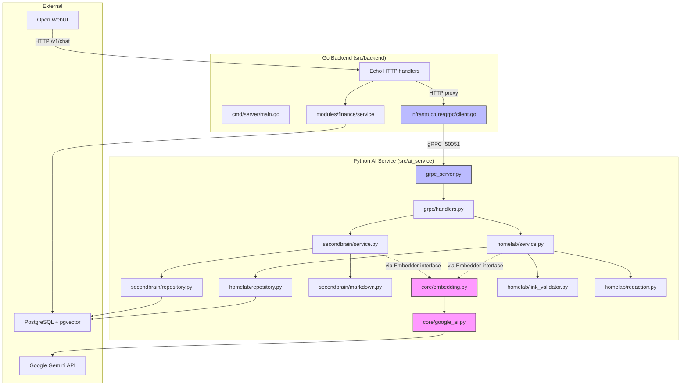

# DETAIL_DESIGN: AI Service Restructuring & gRPC Gateway (Epic 4)

## 1. Context & Reference Links

- **Backlog Item**: [BL-008](file:///Users/dungxbuif/workspace/cortex/docs/work/BACKLOG.md)
- **Phase**: [PHASE-4-restructuring.md](file:///Users/dungxbuif/workspace/cortex/docs/work/phases/PHASE-4-restructuring.md)
- **Ticket**: [CTX-403](file:///Users/dungxbuif/workspace/cortex/docs/work/tickets/epic-4/CTX-403.md)
- **Architecture**: [ARCHITECTURE.md](file:///Users/dungxbuif/workspace/cortex/docs/architecture/ARCHITECTURE.md)
- **Spec**: [spec.md](file:///Users/dungxbuif/workspace/cortex/docs/raw_spec/spec.md)
- **ADR-003**: [ADR-003](file:///Users/dungxbuif/workspace/cortex/docs/decisions/ADR-003-second-brain-python-migration.md)

---

## 2. Codebase Audit — Hiện trạng và Vấn đề

### 2.1. Bản đồ File Hiện tại

```text
src/
├── proto/
│   └── cortex.proto              # ✅ Đã có giao ước gRPC
├── ai_service/
│   ├── __init__.py
│   ├── api.py                    # FastAPI adapter (transport)
│   ├── pyproject.toml
│   ├── core/
│   │   ├── config.py             # Cấu hình DB + Google AI
│   │   ├── google_ai.py          # 🔴 Google Gemini client (embed + generate)
│   │   ├── models.py             # Dataclass entities cho cả SB lẫn Homelab
│   │   ├── repository.py         # 🔴 God class: 1081 dòng, chứa cả SQLite + Postgres + 2 domain
│   │   ├── vector.py             # Token + cosine similarity helpers
│   │   └── migrations.py         # DB migration runner
│   ├── secondbrain/
│   │   ├── service.py            # 🟡 SB service: chứa cả scoring/ranking logic
│   │   └── markdown.py           # 🟡 Markdown parser + chunker: nhận GoogleAIClient để embed
│   ├── homelab/
│   │   └── service.py            # 🟡 Homelab service: chứa cả sync, search, chunk, embed, validate-links
│   ├── orchestrator/             # 🔲 Rỗng (chỉ có __init__.py)
│   ├── grpc/                     # 🔲 Rỗng (chỉ có __init__.py)
│   └── tests/
└── backend/                      # Go monolith
    ├── cmd/server/main.go        # 🔴 Chỉ có /health endpoint, chưa proxy gì
    ├── internal/
    │   ├── config/config.go
    │   ├── core/logger/
    │   ├── infrastructure/db/    # GORM PostgreSQL connector
    │   └── modules/finance/      # ✅ Hoàn chỉnh: domain + service (wallet, tx, asset, debt, report)
    └── migrations/
```

### 2.2. Phát hiện Vi phạm Nguyên tắc (Boundary Violations)

#### 🔴 Vi phạm nghiêm trọng

| # | File | Vấn đề | Nguyên tắc bị vi phạm |
|---|------|--------|----------------------|
| V1 | [google_ai.py](file:///Users/dungxbuif/workspace/cortex/src/ai_service/core/google_ai.py) | Nằm trong `core/` — là shared utility. Nhưng đây là **AI provider client** (embed text, generate text) — nên thuộc về AI/Orchestrator layer, không phải core business utility. | Module Boundary: domain modules không nên phụ thuộc trực tiếp vào LLM/AI provider |
| V2 | [secondbrain/markdown.py:98-120](file:///Users/dungxbuif/workspace/cortex/src/ai_service/secondbrain/markdown.py#L98-L120) | `chunk_markdown()` nhận `GoogleAIClient` trực tiếp và gọi `ai_client.embed_text()` bên trong loop. Domain module gọi thẳng AI API. | Module Boundary: chunking là domain logic, embedding là AI infrastructure |
| V3 | [homelab/service.py:342-365](file:///Users/dungxbuif/workspace/cortex/src/ai_service/homelab/service.py#L342-L365) | `_chunk_homelab_document()` gọi `self.ai_client.embed_text()` trong loop. Giống V2. | Module Boundary: domain gọi thẳng AI provider |
| V4 | [homelab/service.py:163](file:///Users/dungxbuif/workspace/cortex/src/ai_service/homelab/service.py#L163) | `search_knowledge()` gọi `self.ai_client.embed_text(query)` trực tiếp. Domain module tự embed query để search. | Module Boundary: domain module không nên embed query trực tiếp |
| V5 | [secondbrain/service.py:176](file:///Users/dungxbuif/workspace/cortex/src/ai_service/secondbrain/service.py#L176) | `search_knowledge()` gọi `self.ai_client.embed_text(joined_query)` trực tiếp. | Module Boundary: domain module không nên embed query trực tiếp |
| V6 | [repository.py](file:///Users/dungxbuif/workspace/cortex/src/ai_service/core/repository.py) | **God class**: `SqliteSecondBrainRepository` (474 dòng) và `PostgresPsqlSecondBrainRepository` (500+ dòng) đều chứa methods cho **cả** Second Brain **và** Homelab. Đặt tên cũng gây nhầm lẫn (tên "SecondBrain" nhưng chứa cả homelab). | Single Responsibility: mỗi module nên có repository riêng |

#### 🟡 Cải thiện cần thiết

| # | File | Vấn đề |
|---|------|--------|
| I1 | [config.py](file:///Users/dungxbuif/workspace/cortex/src/ai_service/core/config.py) | `SecondBrainSettings` nên đổi tên thành `AIServiceSettings` vì nó cấu hình cho toàn bộ AI service (cả Homelab, cả Orchestrator), không chỉ Second Brain. |
| I2 | [models.py](file:///Users/dungxbuif/workspace/cortex/src/ai_service/core/models.py) | Chứa entities của cả 2 domain (`Capture`, `VaultDocument`, `VaultChunk` + `HomelabDocument`, `HomelabChunk`). Nên tách mỗi domain giữ models riêng. |
| I3 | [api.py](file:///Users/dungxbuif/workspace/cortex/src/ai_service/api.py) | FastAPI app tên `"Cortex Second Brain API"` nhưng serve cả Homelab routes. Nên đổi tên. Sau Epic 4, file này sẽ chỉ dùng cho dev/debug, gRPC là contract chính. |
| I4 | [main.go](file:///Users/dungxbuif/workspace/cortex/src/backend/cmd/server/main.go) | Chỉ có 1 endpoint `/health`. Chưa kết nối Finance service handlers. Chưa có gRPC client. |

---

## 3. Thiết kế Mục tiêu — Kiến trúc Sau Refactor

### 3.1. Design Decision: Ports/Adapters để dễ test và dễ mở rộng

Epic này dùng thiết kế **ports/adapters** thay vì để domain module gọi trực tiếp provider, DB implementation hoặc transport.

Mục tiêu:

- Domain code test được bằng in-memory/fake adapters, không cần Google API, gRPC server hoặc PostgreSQL thật.
- Provider AI đổi được từ Google sang OpenAI/local embedding mà không sửa Second Brain/Homelab business logic.
- Repository tách theo domain để query/report/index không bị lẫn ownership.
- gRPC và FastAPI chỉ là transport adapter, không chứa business rule.
- `grpc_server.py` là composition root duy nhất wire config, provider, repositories, services và transports.

Ranh giới vai trò:

| Layer | Được làm | Không được làm | Test chính |
| --- | --- | --- | --- |
| Domain pure logic | Parse markdown, chunk text, redact, validate links, rank/scoring deterministic | Gọi Google/OpenAI, đọc env, mở socket, chạy SQL | Unit tests không DB/AI |
| Application service | Điều phối use case, gọi repository port, gọi embedding port, enforce owner/defaults | Biết provider cụ thể, serialize protobuf, format HTTP | Unit tests với fake repo/fake embedder |
| Repository adapter | Query PostgreSQL/SQLite cho đúng domain table | Gọi AI, xử lý markdown, xử lý transport | Contract/integration tests |
| AI provider adapter | Gọi Gemini/OpenAI/local model, retry/rate-limit, validate vector dimension | Biết capture/vault/homelab business rules | Provider smoke tests opt-in |
| Transport adapter | Map HTTP/gRPC request-response sang service methods | Chứa business logic hoặc SQL | gRPC/FastAPI adapter tests |
| Composition root | Tạo settings, provider, repos, services, server | Business branching | Startup smoke tests |

Kiến nghị quan trọng: **domain service được phép biết khái niệm `Embedder` port**, vì semantic search/index là use case của domain. Nhưng domain service không được biết `GoogleAIClient`, model name, API key, HTTP endpoint hoặc retry mechanics.

### 3.2. Nguyên tắc Phân tách Trách nhiệm

```text
+-------------------------+       +--------------------------+
| Go Backend Gateway      |       | FastAPI Dev Adapter       |
| HTTP public/internal API |       | Local debug only          |
+-----------+-------------+       +------------+-------------+
            |                                  |
            | gRPC                             | direct call in dev
            v                                  v
+------------------------------------------------------------+
| Python Transport Adapters                                  |
| grpc/handlers.py maps protobuf <-> application services     |
+------------------------------+-----------------------------+
                               |
                               v
+------------------------------------------------------------+
| Application Services                                       |
| secondbrain/service.py | homelab/service.py                 |
| depend on Repository ports + Embedder port                  |
+----------+-------------------------+-----------------------+
           |                         |
           v                         v
+----------------------+     +-------------------------------+
| Domain Logic         |     | Ports                         |
| markdown.py          |     | Embedder Protocol             |
| redaction.py         |     | SecondBrainRepository Protocol|
| link_validator.py    |     | HomelabRepository Protocol    |
+----------------------+     +---------------+---------------+
                                              |
                                              v
+------------------------------------------------------------+
| Infrastructure Adapters                                    |
| providers/google_ai.py | postgres repositories | migrations |
+----------------------+------------------------+------------+
                       |                        |
                       v                        v
                +-------------+          +------------------+
                | Gemini API  |          | PostgreSQL/vector|
                +-------------+          +------------------+
```

### 3.3. Cách Domain Modules Loại bỏ AI Dependency

**Trước (vi phạm):**
```python
# secondbrain/markdown.py — domain module gọi thẳng AI
def chunk_markdown(owner_id, document, markdown, ai_client: GoogleAIClient):
    # ...
    embedding = ai_client.embed_text(text)  # ← 🔴 domain gọi AI
```

**Sau (đúng nguyên tắc):**
```python
# secondbrain/markdown.py — domain module chỉ làm text processing
def chunk_markdown(owner_id, document, markdown) -> list[RawChunk]:
    # ...trả về chunks chưa có embedding

# ai_service/core/ports.py — application port
class Embedder(Protocol):
    def embed_text(self, text: str) -> tuple[float, ...]: ...
    def embed_batch(self, texts: list[str]) -> list[tuple[float, ...]]: ...

# secondbrain/service.py — application service
def index_document(vault_path, markdown, owner_id, embedder: Embedder):
    raw_chunks = chunk_markdown(owner_id, document, markdown)  # domain
    vectors = embedder.embed_batch([chunk.content for chunk in raw_chunks])
    embedded_chunks = attach_vectors(raw_chunks, vectors)
    repository.upsert_document_with_chunks(document, embedded_chunks)  # persist
```

### 3.4. Cấu trúc Thư mục Mục tiêu

```text
src/ai_service/
├── __init__.py
├── pyproject.toml
├── api.py                        # FastAPI dev/debug adapter (đổi tên app)
├── grpc_server.py                # gRPC server entrypoint
│
├── core/                         # Shared infrastructure
│   ├── __init__.py
│   ├── config.py                 # Đổi tên class → AIServiceSettings
│   ├── ports.py                  # [MỚI] Protocols: Embedder, repository contracts
│   ├── vector.py                 # Math utilities (cosine, tokenize)
│   └── migrations.py             # DB migration runner
│
├── providers/
│   ├── __init__.py
│   ├── google_ai.py              # GoogleAIClient, generation + embedding API calls
│   └── embedding.py              # GoogleEmbedder implements Embedder
│
├── secondbrain/                  # Second Brain domain module
│   ├── __init__.py
│   ├── models.py                 # [TÁCH] Capture, VaultDocument, VaultChunk, SearchResult, SyncStatus
│   ├── repository.py             # [TÁCH] SQLite + Postgres methods chỉ cho SB tables
│   ├── markdown.py               # [SỬA] Bỏ GoogleAIClient param; trả về RawChunk (chưa embed)
│   └── service.py                # [SỬA] Nhận EmbeddingService qua DI; delegate embed
│
├── homelab/                      # Homelab domain module
│   ├── __init__.py
│   ├── models.py                 # [TÁCH] HomelabDocument, HomelabChunk, HomelabSearchResult, HomelabSyncStatus
│   ├── repository.py             # [TÁCH] SQLite + Postgres methods chỉ cho Homelab tables
│   ├── redaction.py              # [TÁCH] redact_secrets(), checksum_text(), verify_signature()
│   ├── link_validator.py         # [TÁCH] validate_markdown_links(), gfm_slugify()
│   └── service.py                # [SỬA] Nhận EmbeddingService qua DI; delegate embed
│
├── orchestrator/                 # Orchestrator module (Epic 5 impl)
│   ├── __init__.py
│   └── service.py                # [STUB] Placeholder cho Epic 5 chat loop
│
├── grpc/                         # gRPC transport
│   ├── __init__.py
│   ├── cortex_pb2.py             # [SINH] từ protoc
│   ├── cortex_pb2_grpc.py        # [SINH] từ protoc
│   └── handlers.py               # [MỚI] gRPC servicer implementations
│
└── tests/
```

---

## 4. Chi tiết Từng Thay đổi

### 4.1. [MỚI] `core/ports.py` và `providers/embedding.py` — Tách AI ra khỏi Domain

```python
"""Application ports.

Domain/application services depend on these protocols. Infrastructure adapters
implement them.
"""
from typing import Protocol

class Embedder(Protocol):
    """Interface for embedding text into vectors."""
    def embed_text(self, text: str) -> tuple[float, ...]: ...
    def embed_batch(self, texts: list[str]) -> list[tuple[float, ...]]: ...

class SecondBrainRepository(Protocol):
    def save_capture(self, capture): ...
    def list_searchable_chunks(self, owner_id: str): ...

class HomelabRepository(Protocol):
    def upsert_homelab_document_with_chunks(self, document, chunks): ...
    def list_searchable_homelab_chunks(self, owner_id: str): ...
```

```python
"""Provider adapter."""

class GoogleEmbedder:
    """Concrete Embedder implementation using GoogleAIClient."""
    def __init__(self, ai_client):
        self.ai_client = ai_client

    def embed_text(self, text: str) -> tuple[float, ...]:
        return self.ai_client.embed_text(text)

    def embed_batch(self, texts: list[str]) -> list[tuple[float, ...]]:
        return [self.ai_client.embed_text(t) for t in texts]
```

**Tại sao:** Với `Protocol`, services chỉ khai báo cần port, không quan tâm adapter là Google, OpenAI, fake, hay local model. Tests dùng fake embedder và fake repo. Production inject `GoogleEmbedder`. Provider-specific concerns như API key, endpoint, model name, retry, dimension validation nằm ngoài domain.

**Vị trí provider:** `GoogleAIClient` không nên ở `core/`. Chuyển sang `providers/google_ai.py`; `core/` chỉ giữ primitives, ports, config, vector math và migration runner.

---

### 4.2. [SỬA] `secondbrain/markdown.py` — Bỏ AI coupling

**Thay đổi:**
- `chunk_markdown()` bỏ tham số `ai_client: GoogleAIClient`
- Trả về `list[RawChunk]` (dataclass mới, giống VaultChunk nhưng `embedding` là `None`)
- Caller (gRPC handler hoặc service layer) sẽ gọi `embedding_service.embed_batch()` sau đó

**Lý do:** Chunking text là pure domain logic (xử lý heading, split paragraph). Embedding là AI infrastructure. Hai việc này phải tách riêng để:
- Test chunking nhanh mà không cần mock AI client
- Thay đổi embedding model không ảnh hưởng parsing logic
- Batch embedding hiệu quả hơn embed từng chunk trong loop

---

### 4.3. [SỬA] `secondbrain/service.py` — Nhận Embedder qua DI

**Thay đổi:**
- Constructor: `__init__(self, repository, embedder: Embedder)`
- `search_knowledge()`: gọi `self.embedder.embed_text(query)` thay vì `self.ai_client.embed_text()`
- `index_vault_document()`: gọi `chunk_markdown()` (không AI) rồi `self.embedder.embed_batch()` để embed

**Lý do:** Service class vẫn orchestrate nghiệp vụ (capture lifecycle, search ranking, sync) nhưng delegate phần AI cho injected embedder.

---

### 4.4. [SỬA] `homelab/service.py` — Bỏ AI coupling + Tách file

**Thay đổi:**
1. Di chuyển `redact_secrets()`, `checksum_text()`, `verify_signature()`, regex patterns → `homelab/redaction.py`
2. Di chuyển `validate_markdown_links()`, `gfm_slugify()`, heading/link regex → `homelab/link_validator.py`
3. `HomelabService.__init__()`: nhận `embedder: Embedder` thay vì `ai_client: GoogleAIClient`
4. `_chunk_homelab_document()`: bỏ embed trong loop, trả về raw chunks
5. `search_knowledge()`: gọi `self.embedder.embed_text(query)`

**Lý do:** File hiện tại 382 dòng chứa 4 trách nhiệm khác nhau (redaction, link validation, sync, search). Tách ra giúp mỗi file dưới 150 dòng, dễ test độc lập.

---

### 4.5. [TÁCH] Repository — Mỗi Domain có Repository Riêng

**Hiện tại:** `core/repository.py` (1081 dòng) chứa:
- `SqliteSecondBrainRepository`: methods cho cả SB + Homelab
- `PostgresPsqlSecondBrainRepository`: methods cho cả SB + Homelab
- Helper functions cho cả 2 domain

**Sau:**
- `secondbrain/repository.py`: Chỉ chứa `SecondBrainSqliteRepo` + `SecondBrainPostgresRepo` với methods cho SB tables
- `homelab/repository.py`: Chỉ chứa `HomelabSqliteRepo` + `HomelabPostgresRepo` với methods cho Homelab tables
- `core/repository.py`: Giữ lại shared helpers (`sql_literal`, `vector_literal`, `jsonb_literal`, base `_run_psql`)

**Lý do:** Single Responsibility. Mỗi domain module tự quản lý schema và queries của mình. `core/` chỉ cung cấp DB connection utilities.

---

### 4.6. [TÁCH] Models — Mỗi Domain có Models Riêng

**Hiện tại:** `core/models.py` chứa entities cho cả 2 domain.

**Sau:**
- `core/models.py`: Giữ `DEFAULT_OWNER_ID`, `CaptureStatus`, `IndexStatus`, `utc_now()` (shared enums/utils)
- `secondbrain/models.py`: `Capture`, `VaultDocument`, `VaultChunk`, `RawChunk`, `SearchResult`, `SyncStatus`
- `homelab/models.py`: `HomelabDocument`, `HomelabChunk`, `HomelabSearchResult`, `HomelabSyncStatus`

---

### 4.7. [SỬA] `core/config.py` — Đổi tên Settings

**Thay đổi:**
- `SecondBrainSettings` → `AIServiceSettings`
- Env prefix `SECOND_BRAIN_` giữ nguyên cho backward compatibility, nhưng class name phản ánh đúng scope

---

### 4.8. [MỚI] `grpc/handlers.py` — gRPC Servicer Implementations

Implement các servicer classes được sinh từ protobuf:

```python
class SecondBrainServicer(cortex_pb2_grpc.SecondBrainServiceServicer):
    def __init__(self, service: SecondBrainService): ...
    def CreateCapture(self, request, context): ...
    def SearchSecondBrain(self, request, context): ...

class HomelabServicer(cortex_pb2_grpc.HomelabServiceServicer):
    def __init__(self, service: HomelabService): ...
    def SyncHomelab(self, request, context): ...
    def ValidateLinks(self, request, context): ...
```

Mỗi handler:
1. Deserialize protobuf request → Python dict/params
2. Gọi domain service method
3. Serialize response → protobuf message
4. Catch exceptions → map sang gRPC status codes

---

### 4.9. [MỚI] `grpc_server.py` — Server Entrypoint

```python
def serve(port=50051):
    settings = AIServiceSettings.from_env()
    embedder = GoogleEmbeddingService(GoogleAIClient(settings))

    sb_repo = SecondBrainPostgresRepo.from_env()
    hl_repo = HomelabPostgresRepo.from_env()

    sb_service = SecondBrainService(repository=sb_repo, embedder=embedder)
    hl_service = HomelabService(repository=hl_repo, embedder=embedder)

    server = grpc.server(futures.ThreadPoolExecutor(max_workers=10))
    cortex_pb2_grpc.add_SecondBrainServiceServicer_to_server(
        SecondBrainServicer(sb_service), server)
    cortex_pb2_grpc.add_HomelabServiceServicer_to_server(
        HomelabServicer(hl_service), server)

    server.add_insecure_port(f"[::]:{port}")
    server.start()
    server.wait_for_termination()
```

**Composition Root:** Đây là nơi duy nhất kết nối tất cả dependencies lại — settings, AI client, embedder, repositories, services, gRPC servicers.

---

### 4.10. Go Backend — gRPC Client & Echo Gateway

#### [MỚI] `src/backend/internal/infrastructure/grpc/pb/`
- Chứa code sinh từ protoc: `cortex.pb.go`, `cortex_grpc.pb.go`

#### [MỚI] `src/backend/internal/infrastructure/grpc/client.go`

```go
type AIServiceClient struct {
    secondBrain pb.SecondBrainServiceClient
    homelab     pb.HomelabServiceClient
}

func NewAIServiceClient(addr string) (*AIServiceClient, error) {
    conn, err := grpc.Dial(addr, grpc.WithTransportCredentials(insecure.NewCredentials()))
    // ...
}
```

#### [SỬA] `src/backend/cmd/server/main.go`

```go
func main() {
    cfg := config.Load()
    // ... existing DB, logger setup ...

    // NEW: gRPC client to Python AI Service
    aiClient, err := grpc.NewAIServiceClient(cfg.AIServiceAddress)

    // NEW: Finance service (existing Go module)
    finService := finance.NewFinanceService(dbConn)

    e := echo.New()
    e.GET("/health", healthHandler)

    // Finance routes (Go-native, no gRPC needed)
    registerFinanceRoutes(e, finService)

    // AI Service proxy routes (Go → Python gRPC)
    registerAIServiceRoutes(e, aiClient)

    e.Start(cfg.ServerAddress)
}
```

**Ghi chú quan trọng:**
- Finance routes gọi **trực tiếp** Go `FinanceService` — không cần gRPC vì cùng process.
- AI Service routes (secondbrain, homelab) proxy qua gRPC client tới Python.
- Config mới cần thêm `AI_SERVICE_ADDRESS` (default `localhost:50051`).

---

## 5. Dependency Graph Sau Refactor



**Luồng AI:** `GRPC_HANDLERS → Service → Embedder (interface) → GoogleEmbeddingService → GoogleAIClient → Gemini API`
Domain modules (SB_SVC, HL_SVC) chỉ biết `Embedder` protocol, không biết Google hay OpenAI.

---

## 6. Thứ tự Triển khai (Execution Order)

Thứ tự rất quan trọng vì mỗi bước phải compile/import thành công trước khi tiến hành bước tiếp theo.

| Phase | Bước | Mô tả | Files ảnh hưởng |
|-------|------|-------|-----------------|
| A | A1 | Tạo `core/embedding.py` với `Embedder` protocol và `GoogleEmbeddingService` | [MỚI] core/embedding.py |
| A | A2 | Đổi tên `SecondBrainSettings` → `AIServiceSettings` trong config.py | config.py + tất cả importers |
| B | B1 | Tách models: di chuyển SB entities sang `secondbrain/models.py` | core/models.py, secondbrain/models.py |
| B | B2 | Tách models: di chuyển Homelab entities sang `homelab/models.py` | core/models.py, homelab/models.py |
| C | C1 | Tách repository: extract SB methods sang `secondbrain/repository.py` | core/repository.py, secondbrain/repository.py |
| C | C2 | Tách repository: extract Homelab methods sang `homelab/repository.py` | core/repository.py, homelab/repository.py |
| C | C3 | Giữ shared helpers trong `core/repository.py` (sql_literal, vector_literal, psql runner) | core/repository.py |
| D | D1 | Sửa `secondbrain/markdown.py`: bỏ ai_client, trả về RawChunk | secondbrain/markdown.py |
| D | D2 | Sửa `secondbrain/service.py`: nhận Embedder, delegate embed | secondbrain/service.py |
| D | D3 | Tách homelab: `redaction.py`, `link_validator.py` | homelab/ (3 files mới) |
| D | D4 | Sửa `homelab/service.py`: nhận Embedder, delegate embed | homelab/service.py |
| E | E1 | Sinh Python gRPC stubs từ protoc | grpc/cortex_pb2.py, grpc/cortex_pb2_grpc.py |
| E | E2 | Implement `grpc/handlers.py` | [MỚI] grpc/handlers.py |
| E | E3 | Implement `grpc_server.py` | [MỚI] grpc_server.py |
| F | F1 | Sinh Go gRPC stubs từ protoc | infrastructure/grpc/pb/ |
| F | F2 | Implement Go gRPC client | [MỚI] infrastructure/grpc/client.go |
| F | F3 | Sửa main.go: đăng ký Finance routes + AI proxy routes | cmd/server/main.go |
| G | G1 | Cập nhật api.py (FastAPI) cho phù hợp DI mới | api.py |
| G | G2 | Cập nhật tests imports | tests/ |

---

## 7. E2E Verification Playbook

### Bước 7.1: Khởi động hệ thống

```bash
# Terminal 1: Database
docker start postgres  # hoặc docker-compose up -d postgres

# Terminal 2: Python gRPC Server
PYTHONPATH=src python src/ai_service/grpc_server.py
# Expected log: "gRPC Server listening on port 50051"

# Terminal 3: Go Gateway
cd src/backend && go run cmd/server/main.go
# Expected log: "Starting server on :8080"
# Expected log: "Connected to AI Service gRPC on localhost:50051"
```

### Bước 7.2: Smoke Tests

```bash
# Health check (Go)
curl http://localhost:8080/health
# Expected: {"status":"ok"}

# Create capture via Go → gRPC → Python
curl -X POST http://localhost:8080/api/v1/secondbrain/captures \
  -H "Content-Type: application/json" \
  -d '{"raw_text":"Test capture qua gateway","source":"e2e_test","owner_id":"test"}'
# Expected: {"capture":{"id":"...","status":"captured",...}}

# Validate links via Go → gRPC → Python
curl -X POST http://localhost:8080/api/v1/homelab/validate-links \
  -H "Content-Type: application/json" \
  -d '{"repo_path":"/path/to/test/repo"}'
# Expected: {"status":"completed","broken_links":[...]}
```

---

## 8. Rủi ro & Biện pháp Giảm thiểu

| Rủi ro | Mức độ | Biện pháp |
|--------|--------|-----------|
| Import sai sau refactor → `ModuleNotFoundError` runtime | Cao | Chạy `python -c "from ai_service.secondbrain.service import SecondBrainService"` sau mỗi phase |
| Repository tách sai → missing methods | Cao | Giữ bản cũ trong core/ cho đến khi tách xong + tests pass |
| Protobuf version mismatch Go/Python | Trung bình | Lock protoc version, commit generated code |
| GoogleAIClient rate limit khi test | Thấp | Mock embedder trong unit tests |

---

## 9. Approval Status

- **Trạng thái:** Approved for incremental implementation by ticket breakdown.
- **Người duyệt:** dungxbuif
- **Ghi chú:** Implementation must proceed ticket-by-ticket from `CTX-403` through the continuity gates in `implementation_plan.md`.
